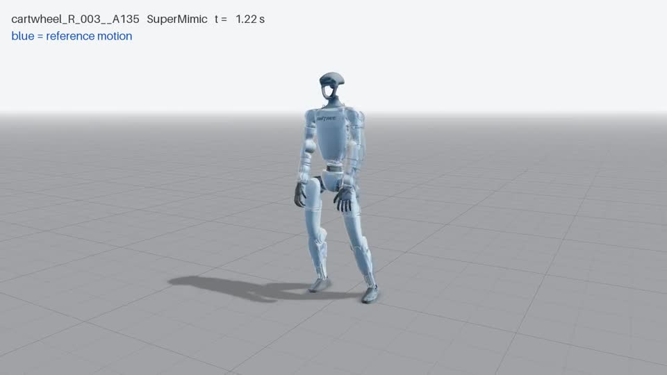
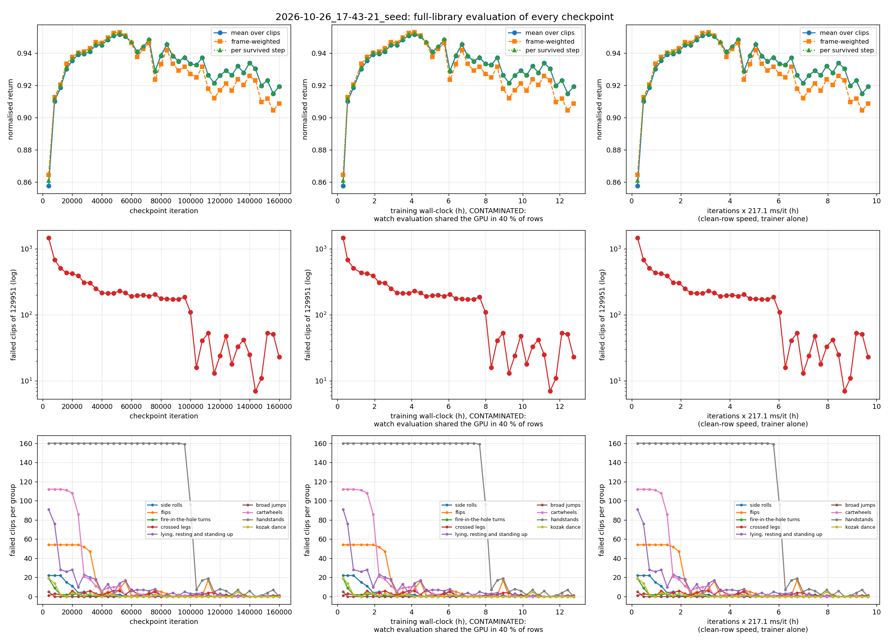

# SuperMimic on mjlab

A re-implementation of SuperMimic for the Unitree G1 on [mjlab](https://github.com/mujocolab/mjlab):
one differentiable world model, fitted on simulator transitions of a whole motion library, trains a single
whole-body tracking policy by backpropagation through imagined rollouts. There is no official code; this
fork (branch `supermimic` of [rihat99/mjlab](https://github.com/rihat99/mjlab)) follows the paper and
says below where it departs from it and why. It trains one policy on the 129,889 BONES-SEED clips that
pass its filters on a single GPU; the results against the paper are below.

[](docs/media/sim_cartwheel.mp4)

More clips (click to play): [side roll](docs/media/sim_side_roll.mp4) ·
[flip](docs/media/sim_flip.mp4) · [handstand](docs/media/sim_handstand.mp4) ·
[standing up](docs/media/sim_stand_up.mp4) · [walk](docs/media/sim_walk.mp4) ·
[wave](docs/media/sim_wave.mp4) · two failures: [handstand](docs/media/sim_failed_handstand.mp4),
[butt-kick jog](docs/media/sim_failed_jog.mp4).

## What SuperMimic is

SuperMimic (Liao et al., 2026, [arXiv:2610.28480](https://arxiv.org/abs/2610.28480),
[project page](https://supermimic.github.io)) trains motion tracking with a learned simulator instead of
model-free RL. A world model of the robot's dynamics is fitted on short windows of logged simulator
transitions from all clips at once. The deterministic policy is improved by backpropagating the tracking
reward through 32-step rollouts imagined in that model, with a critic for the value at the rollout's end.
Resets favour the parts of the library where the return is lowest. The paper reports 25 failed motions of
129,514 after 3 h on one H100, and none after 9.8 h on two.

How it works here, step by step, with the observation, goal, noise and timing details:
[the explainer page](docs/supermimic/index.html) (open the file in a browser).

## What differs from the paper, and why

| item | paper | here | why |
|---|---|---|---|
| Heading | does not say where the policy learns its heading error; the actor reads Table A.1 (93 values per step) | actor exactly Table A.1 (93 × 10 steps); the goal adds, for each of the 10 goal frames, the reference pelvis orientation seen from the robot pelvis (60 values, SONIC's form; goal 790) | the 730 reference values are written in the reference's heading frame, so without this the policy cannot see its heading error and drifts (94° after 60 s on LAFAN1; [observation.md](docs/supermimic/observation.md)) |
| Self-collision | self-collision penalty removed (App. A) | full robot self-collision simulated, no penalty | as on hardware |
| Friction | μ ~ U[0.3, 1.2] (Table A.3) | on every robot collision geom, ground at 0.3 in training | MuJoCo uses the larger friction of two geoms: with a ground of 1.0 only the feet would feel the sampled value |
| Torso CoM offset | per episode, part of the sim context | sampled once per env at startup | changing it runs MuJoCo Warp's `set_const` over all worlds; per episode it doubles the env step (18 → 35 ms at 4096 envs) |
| Critic input | state features, goal, sim context | plus the reference pelvis pose in the robot pelvis frame (9) | the root rewards depend on the xy and heading error that features and goal lack (BeyondMimic's critic terms) |
| Value range | not clamped | critic values clamped to ±10 = max step reward / (1 − γ) in the λ-return targets and bootstraps | as allmimic and morphmimic: an overestimate cannot feed back into its own targets |
| Reset sampling | 0.5 uniform + 0.4 softmax(−25 G/G_max) + 0.1 past weights | each bin's softmax weight capped at 50× the uniform share | allmimic's cap: the hard-bin mass spreads over many bins |
| Termination in imagination | learned | analytic: sigmoids of the env's pelvis height and tilt errors | the rule is known exactly; nothing to fit |
| Clip ends | not discussed | imagined rollouts end at least 10 frames before a clip's end | the critic is never fit there; without the margin its loss blew up on BONES-SEED |
| Warm-up | none | 64 prefill steps, then 500 world-model-only iterations | a usable model before the first policy gradient |
| Precision | TF32 | bfloat16 autocast in the world-model fit and imagination | about twice the matmul rate |
| Update-to-data ratio | 0.4 | 2.5 sim steps per iteration (0.4) | the paper does not define an iteration |
| Library | SONIC's name filter + feasibility filter: 129,514 clips | the same filters, but cartwheels, handstands and the kozak dance kept; plus name terms `off_wall` and `inchworm` and a joint-speed limit of 100 rad/s between frames: 129,889 clips | the kept three need no prop; the wall push-off needs a wall, the inchworm plank's hands sink into the floor, and faster joints are retargeting spikes ([failures](docs/supermimic/failures.md#5-filter-change)) |
| Constraint budget | not given | `njmax` 350 rows per world | with self-collision, hard clips reach 275 rows; MuJoCo Warp silently drops rows beyond the budget |
| Compute | 1 H100 × 3 h; 2 H100 × 9.8 h, data parallel | 1 RTX PRO 6000, single GPU | |

## Results

Evaluation follows the paper (App. F.1): every clip played once from its first frame with the deterministic
policy, friction 1.0, no noise or randomisation. A clip fails when the pelvis height error exceeds 0.25 m or
its tilt error 0.8; the normalised return divides the summed reward by the maximum over the whole clip.
The policy in `checkpoints/seed` is iteration 144,000 of a 160k-iteration run, the checkpoint with the fewest
failed clips. Over all 129,889 clips: **7 failed** (a repeat evaluation gives 15, 6 of them the same:
MuJoCo Warp is not bitwise deterministic, and these clips sit at the edge of the termination threshold) and
a mean normalised return of **0.940** in both evaluations.

Failed motions per group of the paper's Table A.8. Our groups are found by motion name; flips and
lying/standing up only approximate the paper's sets, the dance routine cannot be identified, and the last
three groups are ours.

| motion group (clips here / paper) | here: failed | here: mean return | SONIC | SuperMimic 1 GPU × 3 h | SuperMimic 2 GPUs × 9.8 h |
|---|---|---|---|---|---|
| side rolls (22 / 22) | 0 | 0.827 | 22 | 2 | 0 |
| flips (54 / 44) | 1 | 0.801 | 44 | 1 | 0 |
| fire-in-the-hole turns (20 / 20) | 0 | 0.847 | 3 | 3 | 0 |
| crossed legs (10 / 10) | 0 | 0.827 | 9 | 0 | 0 |
| lying, resting and standing up (102 / 99) | 0 | 0.877 | 28 | 8 | 0 |
| broad jumps (24 / 24) | 0 | 0.846 | 15 | 0 | 0 |
| dance routine (– / 8) | – | – | 8 | 0 | 0 |
| cartwheels (112 / –) | 0 | 0.841 | – | – | – |
| handstands (160 / –) | 4 | 0.624 | – | – | – |
| kozak dance (90 / –) | 0 | 0.591 | – | – | – |
| all other (129,295 / 129,287) | 2 | 0.941 | 50 | 11 | 0 |
| **total (129,889 / 129,514)** | **7** | **0.940** | **179** | **25** | **0** |

The repeat evaluation fails 2 flips, 2 crossed-legs clips, 1 broad jump, 5 handstands and 5 others.

Against the policy this fork shipped before, which read the heading term in the observation (99 values per
step) and was trained and evaluated, with the same schedule, on the 129,951 clips from before our three
filter rules:

| policy at iteration 144,000 | clips | failed, two evaluations | on the 129,889 shared clips | mean return |
|---|---|---|---|---|
| heading in the goal (this one) | 129,889 | 7, 15 | 7, 15 | 0.940 |
| heading in the observation | 129,951 | 7, 10 | 6, 9 | 0.930 |

The earlier policy failed no clip of the named groups and its failures were all in "all other"; this one
fails four handstands, a flip, a jog with butt kicks and a turn on all fours, and gains 0.01 of return.

Budget: here one RTX PRO 6000 Blackwell, 144,000 iterations at 4096 envs, 8.5 h of training at the trainer's
own speed (11.3 h wall-clock, as an evaluation of every checkpoint shared the GPU). The paper: SONIC is the
released checkpoint (128 L40 GPUs for 168 h); SuperMimic 3 h on one H100 or 9.8 h on two.



The return reaches 0.95 by iteration 40,000 and then moves between 0.929 and 0.950, while the failed count
falls from 1,549 at 4,000 to 7 at 144,000. The 160 handstands fail as a block until iteration 80,000 and are
learned between 84,000 and 92,000. From 108,000 on, the failed count moves between 7 and 24 from one
checkpoint to the next. Which clips fail and why: [failures.md](docs/supermimic/failures.md), an analysis
of the earlier policy's failures.

How well the world model predicts the simulator: the policy acts from the same simulated state in both,
on four clips, four start frames each (mean error of imagination vs simulation; `tools/imagine_video.py`).

| clip | root position, step 32 | joints, step 32 | root position, step 128 | joints, step 128 | reward over 32 steps, imagined / simulated |
|---|---|---|---|---|---|
| walk | 0.31 cm | 0.20° | 1.50 cm | 0.20° | 0.977 / 0.976 |
| cartwheel | 2.12 cm | 1.39° | 9.80 cm | 2.91° | 0.882 / 0.880 |
| flip | 2.09 cm | 0.62° | 8.82 cm | 2.33° | 0.815 / 0.823 |
| side roll | 2.55 cm | 1.30° | 8.01 cm | 2.05° | 0.837 / 0.827 |

At the training horizon (32 steps, 0.64 s) imagination is on average 0.3 to 2.6 cm from the simulator and
its reward within 0.01 of the simulated one (0.04 at worst for one start). Beyond it, contact-rich and
airborne phases drift: by step 128 the root is 1.5 cm off on the walk and 8 to 10 cm on the other three
clips, 20 cm at worst for one flip start.

## Documentation

- [Explainer page](docs/supermimic/index.html): the method as implemented, with videos of simulation and
  imagination side by side.
- [observation.md](docs/supermimic/observation.md): where the policy gets its heading, compared with
  BeyondMimic, SONIC and other re-implementations.
- [failures.md](docs/supermimic/failures.md): the clips the policy fails and why.
- [usage.md](docs/supermimic/usage.md): install, data preparation, training, evaluation, videos,
  configuration, compute.
- [changelog.md](docs/supermimic/changelog.md): what this fork adds to mjlab.

## Try it

```bash
git clone -b supermimic https://github.com/rihat99/mjlab.git && cd mjlab && uv sync --extra cu130
.venv/bin/python tools/view.py --run-dir checkpoints/seed --clip side_roll_R_001__A304_M --motions-dir data/motions/seed
```

The second line opens the policy on one clip in the browser; it needs the BONES-SEED clips converted
first ([usage.md](docs/supermimic/usage.md)).

## Data licences

- BONES-SEED ([bones-studio/seed](https://huggingface.co/datasets/bones-studio/seed)) is under its own
  licence agreement (academic and qualifying-startup use; no redistribution of the raw data). Motion Data
  by Bones Studio (https://bones.studio/).
- LAFAN1 ([LAFAN1 Retargeting Dataset](https://huggingface.co/datasets/lvhaidong/LAFAN1_Retargeting_Dataset)):
  CC BY-NC-ND 4.0.
- The code, like mjlab, is under the Apache-2.0 licence.

## References

- SuperMimic: Q. Liao et al., *SuperMimic: Scaling Humanoid Whole-Body Control with One Differentiable World
  Model*, [arXiv:2610.28480](https://arxiv.org/abs/2610.28480), [supermimic.github.io](https://supermimic.github.io).
- mjlab: K. Zakka et al., [arXiv:2601.22074](https://arxiv.org/abs/2601.22074),
  [github.com/mujocolab/mjlab](https://github.com/mujocolab/mjlab).
- BeyondMimic: [arXiv:2508.08241](https://arxiv.org/abs/2508.08241),
  [github.com/HybridRobotics/whole_body_tracking](https://github.com/HybridRobotics/whole_body_tracking)
  (reward, action and critic terms).
- SONIC: Z. Luo et al., *SONIC: Supersizing Motion Tracking for Natural Humanoid Whole-Body Control*,
  [arXiv:2511.07820](https://arxiv.org/abs/2511.07820),
  [github.com/NVlabs/GR00T-WholeBodyControl](https://github.com/NVlabs/GR00T-WholeBodyControl) (name filter,
  goal heading term).
- Other re-implementations we compared with: [Uni-SuperMimic](https://github.com/Motphys/Uni-SuperMimic)
  (reference goal layout), [supermimic_vibed](https://github.com/zita-ch/supermimic_vibed) (soft
  termination temperatures), [SuperMimic-Reproduced](https://github.com/CuboiLeo/SuperMimic-Reproduced)
  (feasibility-filter gates), [allmimic](https://github.com/Shimingyi/allmimic) (value clamp, softmax cap),
  [morphmimic](https://github.com/lzyang2000/morphmimic), [realmimic](https://github.com/kevinhenryzz/realmimic).

```bibtex
@article{liao2026supermimic,
  title={SuperMimic: Scaling Humanoid Whole-Body Control with One Differentiable World Model},
  author={Liao, Qiayuan and Shao, Yiyang and Long, Junfeng and Zakka, Kevin and Horowitz, Roberto and Abbeel, Pieter and Sreenath, Koushil},
  journal={arXiv preprint arXiv:2610.28480},
  year={2026}
}

@misc{zakka2026mjlablightweightframeworkgpuaccelerated,
  title={mjlab: A Lightweight Framework for GPU-Accelerated Robot Learning},
  author={Kevin Zakka and Qiayuan Liao and Brent Yi and Louis Le Lay and Koushil Sreenath and Pieter Abbeel},
  year={2026},
  eprint={2601.22074},
  archivePrefix={arXiv},
  primaryClass={cs.RO},
  url={https://arxiv.org/abs/2601.22074},
}
```
