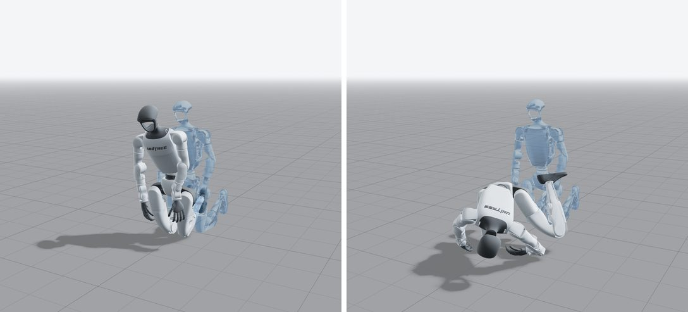
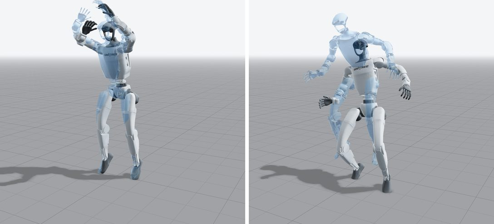
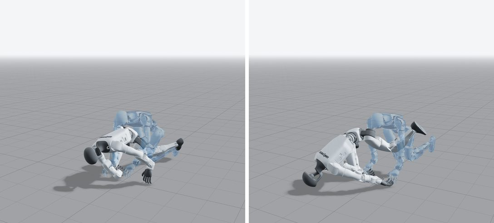
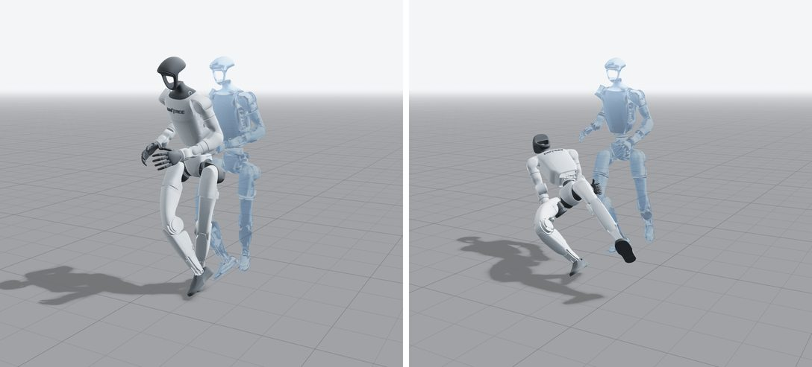
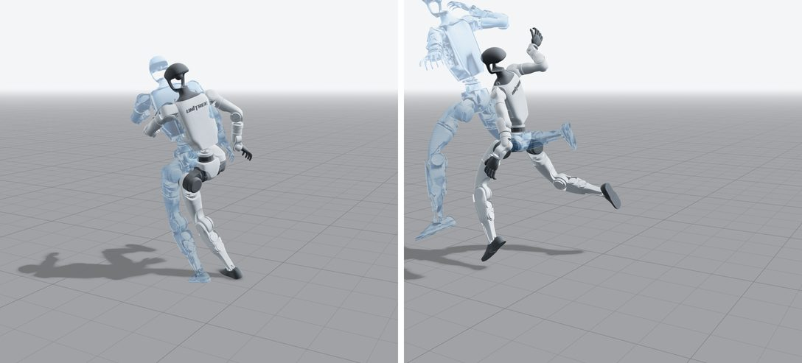
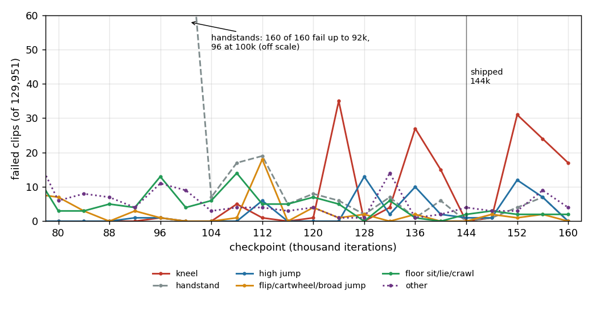

# Why a few clips fail

This note analyses the BONES-SEED policy this fork shipped before the current one: iteration 144k of
`runs/seed/2026-10-26_17-43-21_seed`, with the heading term in the observation (99 values per step), trained and
evaluated on 129,951 clips (the library before the filter change of §5). It tracks all but about ten of them.
This note asks which clips fail, how stable that set is, and why. It assumes you know the method; the [explainer
page](index.html) covers training and evaluation, and [observation.md](observation.md) covers what the actor
observes.

The numbers come from the 16 full-library evaluations of the SEED run and from replays and reference-motion
statistics computed for this diagnosis. Sources named under the tables live in the diagnosis notes
(`agent_notes/tasks/2026-10-27_19-01_supermimic_diagnostics/subagents/`, outside this repository): `A_failures/`
holds the data, `X_fail_review/` an adversarial review of the first reading. A failure *event* is one clip failing
in one evaluation.

**The current policy** (`checkpoints/seed/model_144000.pt`: heading in the goal, iteration 144k of
`runs/seed/2026-10-27_22-48-41_seed_goal_heading_filtered`, 129,889 clips) was not analysed here. It fails 7 clips in
its first full evaluation and 15 in a repeat, 6 in both: `flip_180_R_003__A304`, `handstand_ff_loop_270_R_102__A304_M`,
`handstand_ff_start_270_R_001__A304`, `jog_butt_kick_R_loop_002__A362`,
`show_bicep_R_on_all_fours_360_start_R_idle_right_R_002__A474_M` and `turn_handstand_270_R_001__A304`; the first
evaluation adds `handstand_ff_stop_360_R_002__A304`, the repeat two crossed-legs clips (`crossed_legs_R_001__A430`,
`_A432_M`), `broad_jump_002__A362_M`, `flip_090_003__A304`, two handstands, two more butt-kick jogs of actor A362 and
`Stop_backward_Walk_001__A017`. None of the eleven clips the earlier policy failed at 144k (§4.4) fails in either
evaluation; the wall run has left the library. Four of the 16 are in the union analysed below (the two crossed-legs
clips, §3.5, and two handstands, §3.2), and the families recur (handstands, flips, jumps, cross-legged sitting); the
butt-kick jogs and the turn on all fours are new. Over its 15 checkpoints from 104k to 160k plus the repeat, the
current run fails 168 distinct clips in 262 events (here: 315 clips, 468 events); 57 of them are in this note's union.

How stable the current policy's 16 failures are: two more evaluations of just these 16 clips with
`checkpoints/seed/model_144000.pt` (one process each, 16 environments) fail 9 and 11 of them. Over the four runs, 5
clips fail in 4 of 4 (`flip_180_R_003__A304`, `handstand_ff_start_270_R_001__A304`, `jog_butt_kick_R_loop_002__A362`,
`show_bicep_R_on_all_fours_360_start_R_idle_right_R_002__A474_M`, `turn_handstand_270_R_001__A304`), 5 in 3 of 4
(`Stop_backward_Walk_001__A017`, `broad_jump_002__A362_M`, `flip_090_003__A304`, `handstand_ff_loop_270_R_102__A304_M`,
`jog_butt_kick_R_start_002__A362`), 1 in 2 of 4 (`handstand_ff_stop_360_R_002__A304`) and the other 5 in 1 of 4. A run
fails 10.5 of these 16 on average; the first evaluation's 7 is the lowest of the four draws (7, 15, 9, 11). No clip
returns the same value in any two runs (`Stop_backward_Walk_001__A017`: 0.918 once, 0.13 three times). Sources: the full
evaluations `runs/seed/2026-10-27_22-48-41_seed_goal_heading_filtered/eval_library_model_144000.json` and
`eval_library_model_144000_repeat.json`; the 16-clip runs `X_final_review/eval16_r1.json` and `eval16_r2.json` in the
diagnosis notes (`evaluate_library --checkpoint-file checkpoints/seed/model_144000.pt`).

## 1. Headline

- The analysed checkpoint fails 7 and 10 of 129,951 clips in two full evaluations (11 distinct clips, 6 in both).
- Every checkpoint from 104k to 160k fails 7 to 53 clips. Over 16 evaluations, 315 clips (238 motions) fail at
  least once, 468 events in total. 224 of the 315 fail only once; no clip fails in more than 6 of the 16.
- Re-running a checkpoint repeats 70 % of its failures (36–86 % per checkpoint); the rest move because runs are
  not bit-reproducible (source not isolated; [usage.md](usage.md#evaluate)). Which skills fail depends strongly on
  the checkpoint.
- Few failures come from props: one wall-run motion. Most come from a few families of very hard motions or of
  retargets that sink into the floor or self-intersect. The largest family (kneel loops) is a checkpoint-dependent
  toppling whose trigger is still unknown.
- Per family, in one line each:

| family | clips | events | share | answer | confidence |
|---|---|---|---|---|---|
| kneel loops (+ starts/stops) | 109 | 162 | 35 % | topple at some checkpoints only; penetrating reference implicated; drift and reset sampler are not the trigger | trigger open |
| handstands | 48 | 90 | 19 % | pelvis sinks; actuators at their limits; learned only at ~100k | medium |
| floor sitting, lying, crawling | 41 | 62 | 13 % | fail while rising or roll over; references under the floor with legs interpenetrating | medium (retarget implicated) |
| high jumps | 37 | 56 | 12 % | the most extreme jumps of the library; pass or fail by millimetres of height | high |
| flips, cartwheels, broad jumps | 27 | 33 | 7 % | ballistic extremes; 18 of the 33 events at one checkpoint (112k) | high (hard) |
| self-collision trips | 15 | 19 | 4 % | the robot's legs touch and it trips; reference keeps clearance | medium |
| sporadic single falls | 14 | 14 | 3 % | ordinary motions, failed once, never in replays | high (chance) |
| inchworm plank | 5 | 9 | 2 % | falls rising from a plank whose reference sinks the hands into the floor | low as a class |
| wall run | 3 | 6 | 1 % | the motion pushes off a wall that the scene does not have (missed prop) | high |
| the rest | 16 | 17 | 4 % | kozak, deep crouches, dance jumps, a dog-leash pull, one IK flip | mixed |

Source: `A_failures/failures.csv` (one row per clip), `A_failures/union.json`; families as in
`A_failures/scripts/classify.py`.

## 2. Protocol

**Evaluations.** Each evaluation plays every library clip once from its first frame, one environment per clip, with
the play configuration (no observation noise, no domain randomisation, foot friction 1.0, no reset noise) and the
deterministic policy (`src/mjlab/tasks/tracking/scripts/evaluate_library.py`). The failure set is the union over 16
evaluations: the 15 checkpoints 104k, 108k, …, 160k and a repeat of 144k.

**Failed** means a training termination fired before the clip ended (`checkpoints/seed/params/env.yaml`,
`src/mjlab/tasks/tracking/mdp/kernels.py`):

- `anchor_pos`: pelvis height error |z_ref − z_robot| > 0.25 m (height only; horizontal drift never terminates);
- `anchor_ori`: |g_z,ref − g_z,robot| > 0.8, where g_z is the z component of gravity in the pelvis frame. For an
  upright reference this fires at about 78° of tilt. For a tilted reference it is one-sided: with a 60° reference
  it fires only past about 107°, and leaning more upright never fires.

The control step is 0.02 s, so time in the clip = failure frame × 0.02 s.

**Replays.** To separate the checkpoint from chance, the 315 clips were replayed at each checkpoint with the same
environment, policy and episode loop (17 late replays: the 15 checkpoints plus two more at 144k; 3 early ones at
52k, 80k, 100k). A replay covers only the 315 clips, so its "new" failures are a lower bound for the library.

| checkpoint | 104k | 108k | 112k | 116k | 120k | 124k | 128k | 132k | 136k | 140k | 144k | 148k | 152k | 156k | 160k | total |
|---|---|---|---|---|---|---|---|---|---|---|---|---|---|---|---|---|
| failed in evaluation | 16 | 41 | 53 | 13 | 24 | 48 | 18 | 33 | 42 | 25 | 7 | 11 | 53 | 51 | 23 | 458 |
| failed in replay | 13 | 36 | 51 | 10 | 22 | 49 | 16 | 26 | 40 | 23 | 8 | 8 | 42 | 44 | 14 | 402 |
| repeated | 10 | 29 | 45 | 9 | 18 | 34 | 14 | 21 | 34 | 14 | 6 | 4 | 36 | 39 | 9 | 322 |
| repeated share | 62 % | 71 % | 85 % | 69 % | 75 % | 71 % | 78 % | 64 % | 81 % | 56 % | 86 % | 36 % | 68 % | 76 % | 39 % | 70 % |

Source: `A_failures/replays/replay_<ckpt>.npz`, `A_failures/union.json`. The two extra replays at 144k fail 11 and 9
of the 315 clips; the two full evaluations fail 7 and 10. So 144k is reproducibly low, but its neighbours are not
(140k: 25, 148k: 11), and picking the checkpoint with the fewest failures picks a lucky one.

## 3. Failure families

### 3.1 Kneel loops: checkpoint-dependent toppling

109 clips, 162 events (35 %): 93 of the library's 418 kneel loops (145 events), 15 of 455 kneel starts, 1 of 396
kneel stops. Kneel loops did not fail once in the 22 evaluations from 20k to 104k (the 6 kneel failures there
hit one stop and one start clip), and none of the 109 failing kneel clips fails in the replays at 52k, 80k and 100k. Late
checkpoints fail many at once: 35 at 124k, 27 at 136k, 15 at 140k, 31 at 152k, 24 at 156k, 17 at 160k, but 0 at 144k
and 1 at 148k. All 162 events are `anchor_ori`: the robot topples. They come early: 59 of 162 (36 %) in the first 3
s of the clip, 10th percentile 1.9 s; `kneeling_loop_002__A245` falls at 2.5 s.

*`kneeling_loop_002__A245`, replay at 144k, t = 1.98 s and 2.48 s. Blue: reference.*

**The reference is in the floor.** The lowest point of every failing kneel reference (the knees) sits 5.5–14 cm
under the floor (median 9 cm); the robot cannot follow, and its pelvis stays about 7 cm above the reference at every
checkpoint. Raising the references by a constant cut the late-replay kneel failures from 144 to 101 (17 replays).
Penetration contributes.

**Drift is not the trigger.** The actor does not observe its horizontal root-position error, and kneeling robots
slide away from the reference. But that holds at every checkpoint. Re-running 173 kneel loops (the 93 that fail plus
80 that never fail) at four checkpoints:

| checkpoint | kneel loops failed | passing runs drifting > 0.67 m | median max drift, failing / passing runs | max drift of a passing run |
|---|---|---|---|---|
| 100k | 0 | 52 of 173 | – / 0.22 m | 3.7 m |
| 124k | 30 | 50 of 143 | 1.22 / 0.16 m | 4.1 m |
| 144k | 0 | 33 of 173 | – / 0.11 m | 1.8 m |
| 152k | 21 | 62 of 152 | 0.68 / 0.51 m | 3.4 m |

Source: `X_fail_review/kneel_drift.json` (`X_fail_review/scripts/kneel_drift.py`). 0.67 m is the median horizontal
distance from the reference at which the 144 late replayed kneel failures toppled (`A_failures/replays/`). Large
drift is common where no kneel falls. Failing runs drift more at 124k, so drift may be part of how a fall unfolds,
but it does not decide which checkpoints fail.

**The reset sampler is not the cause.** Each checkpoint stores the return-based sampler's state. Rebuilding its
reset distribution gives the mass on each family, as a multiple of a uniform draw over the reset bins:

| checkpoint | handstands | kneels | high jumps | flips | kneel mean bin return | rest mean bin return |
|---|---|---|---|---|---|---|
| 96k | 22.06 | 1.16 | 1.57 | 7.74 | 7.82 | 8.15 |
| 104k | 21.54 | 1.19 | 1.62 | 8.43 | 7.99 | 8.33 |
| 124k | 20.50 | 1.22 | 1.63 | 9.17 | 8.31 | 8.66 |
| 144k | 20.41 | 1.28 | 1.68 | 9.44 | 8.51 | 8.88 |
| 160k | 20.60 | 1.33 | 1.69 | 9.92 | 8.62 | 9.01 |

Source: `X_fail_review/scripts/sampler_check.py` (re-run for this note). The sampler did not move weight away from
kneels (it moved slightly towards them), and the kneel return seen in training rises smoothly through the bad
checkpoints. The regression shows only in evaluation.

Confidence: penetration implicated (medium); trigger open. Fix: not a filter problem. Candidates are re-solving the
kneel retargets so the knees rest on the floor, and checking the frame-0 reset, which starts the robot in the
penetrating pose (§6). Both need a retrain to test.

### 3.2 Handstands: actuator limits, learned late

48 clips, 90 events (19 %). All 160 handstand clips failed in every evaluation up to 92k; 96 failed at 100k and 7 at
104k. Since then 0–19 fail per checkpoint (0 at 144k), and 130 of 144 replays of these 48 clips at 52k, 80k and 100k
fail. 87 of 90 events are `anchor_pos`: the pelvis sinks 0.25 m below the reference, slowly (the error starts
growing a median 0.64 s before the failure, against 0.22 s for kneels). In the replayed late failures, the wrist and
waist actuators are at ≥ 95 % of their force limit in the last 0.5 s (right wrist yaw in 83 of 92, left wrist yaw
76, waist roll 72). The same check flags a wrist in 116 of 144 kneel failures, so saturation near the fall does not
by itself separate cause from consequence. The reset sampler already puts about 20 times the uniform mass on
handstands (§3.1 table). Confidence: medium. Fix: none proposed. They pass at 144k (group return 0.671); SONIC drops
handstands entirely.

### 3.3 High jumps: ballistic extremes, millimetre margins

37 clips, 56 events (12 %), all `anchor_pos`, 1.3–2.4 s into the clip (median 1.5 s), around and after the apex.
These are the most extreme jumps in the library: centre-of-mass (CoM) rise 0.38–0.52 m (99.3–99.9th percentile of
all clips), take-off speed 1.77–2.42 m/s. The robot jumps lower and lands while the reference is still in the air
(pelvis 0.26 m below the reference at the failure, median). Replays show how thin the margin is:

| replay checkpoint | 52k | 80k | 100k | 104k | 112k | 128k | 136k | 144k | 152k | 160k |
|---|---|---|---|---|---|---|---|---|---|---|
| high jumps failed (of 37) | 0 | 0 | 0 | 0 | 6 | 13 | 11 | 2 | 8 | 0 |
| peak height error of passing runs / 0.25 m (median) | 0.62 | 0.59 | 0.69 | 0.73 | 0.91 | 0.89 | 0.87 | 0.81 | 0.90 | 0.81 |

Source: `A_failures/replays/replay_<ckpt>.npz` (`max_h_err`), selected columns. Late checkpoints jump a few
centimetres lower, and at the edge of the 0.25 m threshold that flips a dozen clips. An ankle pitch actuator is
within 5 % of its force limit in the last 0.5 s of some replayed failures (left 11, right 5 of 53), so torque is
part of it, not all of it. Confidence: high that these are margin failures; why late checkpoints jump lower is open.
Fix: nothing in the library.

*`high_jump_R_102__A389` at 144k, t = 1.00 s and 1.50 s: the robot (white) peaks below the reference (blue).*

### 3.4 Flips, cartwheels, broad jumps

27 clips (22 flips, 2 cartwheels, 3 broad jumps), 33 events (7 %), 18 of them at 112k alone; 0–4 at every other
checkpoint, 5 failures in the early replays. Ballistic flight of 0.34–0.64 s with take-off up to 2.4 m/s; the robot
fails a median 2.7 s into the clip, in the air in 18 of 27 replayed failures. The paper's flip, cartwheel and
broad-jump groups are all failure-free at 144k. Confidence: high (hard motions, checkpoint-specific). Fix: nothing.

### 3.5 Floor sitting, lying, crawling: penetration and leg overlap

41 clips (14 floor sitting, 7 getting up from lying, 20 crawls), 62 events (13 %). They fail late in the clip
(median 72 % of its length, 8.9 s), while rising or by rolling over. 13 failures also occur in the early replays, so
this is not only a late regression. The references are retarget-suspect: their lowest point is 2.5–26 cm under the
floor (median 8 cm), and the two legs interpenetrate by more than 2 cm in all 14 floor-sitting clips and 9 of the 20
crawls. In `mohak_forward_start_101__A122_M`, which fails in all five 144k runs, the thighs interpenetrate by up to
10.3 cm for 109 frames.

*`mohak_forward_start_101__A122_M` at 144k, t = 3.22 s and 3.72 s: the robot rolls over (`anchor_ori`).*

A constant lift out of the floor made floor sitting and lying worse (27 → 52 late-replay failures) and crawls barely
better (15 → 12). That test is confounded: a constant lift leaves the feet floating and changes the motion, so it
does not clear penetration. Confidence: medium that the retarget contributes. Fix: re-retarget with floor and
leg-collision constraints, then retrain.

### 3.6 Self-collision trips

15 clips, 19 events (4 %): jogs, turns, sideways steps, a high-knee exercise, a dog walk, three dance clips. In 19
of 20 replayed failures of the 14 clips with clean references, the robot's feet, shins or knees touch in the last
0.5 s while the reference keeps 1.5–10 cm of clearance; the 15th clip (`walk_ff_start_270_R_slow_001__A446`) has
reference legs that touch (2 mm overlap). None of them fails in the early replays. Self-collision was switched on
for this run.

*`jog_sideway_045_stop_004__A021_M` at 144k, t = 2.32 s and 2.82 s.*

The caveat is the base rate: leg contact in the last 0.5 s is also common in other failures (kneels 96 of 144, floor
sitting 18 of 24, flights 18 of 27), and passing locomotion was not measured. `walk_sideway_right_loop_001__A028_M`
has only 1.5 cm reference clearance, next to the 1 cm limit of the retarget. Confidence: medium. Fix: a training
change (exclude foot–foot collision pairs, or a clearance term), untested.

### 3.7 Sporadic single falls

14 clips, 14 events (3 %): ordinary jogs, walks, turns and gestures that failed once in 16 evaluations and in none
of the 17 late replays. When they pass, their peak error is 0.19–0.88 of the threshold (median 0.33), so these are
rare falls, not threshold noise. They fail late in long clips (median 18.7 s into the clip), consistent with a small
per-second hazard (§4.2). Fix: nothing.

### 3.8 Inchworm plank

5 clips, 9 events (2 %), mostly `anchor_ori`, 3.8–7.3 s in, as the robot rises out of the plank. In the plank the
reference hands sit 7.6–10.8 cm under the floor and the CoM stays 0.38–0.42 m outside the floor contacts for 0.3–0.8
s while still. But inchworm takes that never fail look the same or worse (A360 and A361 takes 002/003 unsupported
for 1.1–2.7 s, A359 hands 12 cm under the floor), so the evidence does not separate failing from passing takes.
Confidence: low as a retarget class. Fix: drop the motion type (`inchworm`, §5) or re-retarget.

### 3.9 Wall run: a missed prop

3 clips (`hook_jump_off_wall_R_101__A305`, its mirror, `hook_jump_off_wall_R_003__A304`), 6 events (1 %). The
metadata says prop "wall" and describes a jump off the wall during a hook punch; the scene has no wall. The robot
fails 1.7–2.5 s into the clip, in the air, pelvis 0.26 m below the reference. `R_101__A305` (either side) fails in
28 of all 40 evaluations of the run: every one from 4k to 104k, then 120k and 144k. Even its passing late runs reach
0.78–0.96 of the height threshold (largest error per clip). As support, not proof: during the 0.58–0.62 s airborne
phase the reference CoM accelerates down at only 6.3–6.7 m/s² with 2.4–2.8 m/s² sideways, while floor high jumps
never exceed −7.5 m/s² (median −9.2, 856 clips). The quadratic fit has 2–3 m/s² of slack (41 of 1,601 reach jumps
and 6 of 24 broad jumps also exceed −7). Confidence: high. Fix: name term `off_wall` (8 clips, all the same motion).

*`hook_jump_off_wall_R_101__A305` at 144k, t = 1.38 s and 1.88 s.*

### 3.10 The rest

| clips | events | what | note |
|---|---|---|---|
| 5 kozak dance | 5 | cossack squat kicks | every kozak reference has slow moments with its CoM 0.21–0.61 m outside the floor contacts; group return 0.59 |
| 4 `h_b_w` crouches | 4 | rise from a deep crouch behind a wall | the wall is cover, not touched |
| 3 dance / one-leg jumps | 3 | jumps | |
| `medium_light_…_A526_M` | 2 | rise from sitting on the heels | fails in all five 144k runs; its mirror twin, with near-identical reference statistics, never fails; cause open |
| `confusion_003__A036` | 1 | gesture | reference shoulder yaw flips 2.7 rad in one frame (129 rad/s); removed by the joint-speed rule |
| `idle_one_foot_right_003__A021_M` | 1 | 20 s on one leg | |
| `walk_the_dog_…pull_leash…A492` | 1 | dragged by a dog | not reproduced in any replay |

Source: `A_failures/failures.csv`, `A_failures/refstats/ref_stats.json`.

## 4. Cross-cutting findings

### 4.1 Mirror twins

Almost every library motion also exists mirrored (`_M`), a free control: same motion, other side. 77 of the 238
failing motions fail on both sides. But 8 of the 11 clips that fail at 144k have a twin that never fails in the 16
evaluations (the exceptions are the wall run and the two high jumps), and so do 34 of the 91 clips that fail at
least twice. There is no overall side bias: 155 of the 315 failing clips are mirrors (49 %; library 50 %). The
motion is trackable on one side, so these failures sit in the policy (a left-right asymmetry) or in chance, not in
the motion.

### 4.2 Clip length

| clip length | clips | failed at least once | per 1,000 clips | per hour of motion |
|---|---|---|---|---|
| < 5 s | 50,674 | 74 | 1.5 | 1.5 |
| 5–10 s | 57,457 | 130 | 2.3 | 1.2 |
| 10–20 s | 18,279 | 89 | 4.9 | 1.3 |
| 20–40 s | 2,717 | 9 | 3.3 | 0.5 |
| 40–100 s | 710 | 9 | 12.7 | 0.7 |
| ≥ 100 s | 114 | 4 | 35.1 | 1.1 |

Source: the 144k evaluation JSON (clip lengths) and `A_failures/union.json`. Longer clips fail more often per clip,
but per hour of motion the rate is roughly flat: a long clip has more seconds in which to fall. Kneel loops are the
exception: all are under 20 s, and 22 % of them fail against 3 % of kneel starts and 0.3 % of stops.

### 4.3 Checkpoint dependence

| family | 104k | 108k | 112k | 116k | 120k | 124k | 128k | 132k | 136k | 140k | 144k | 148k | 152k | 156k | 160k |
|---|---|---|---|---|---|---|---|---|---|---|---|---|---|---|---|
| kneel | 0 | 5 | 1 | 0 | 1 | 35 | 0 | 4 | 27 | 15 | 0 | 1 | 31 | 24 | 17 |
| handstand | 7 | 17 | 19 | 5 | 8 | 6 | 2 | 7 | 1 | 6 | 0 | 1 | 4 | 7 | 0 |
| high jump | 0 | 0 | 6 | 0 | 0 | 0 | 13 | 2 | 10 | 2 | 1 | 1 | 12 | 7 | 0 |
| flip, cartwheel, broad jump | 0 | 1 | 18 | 0 | 4 | 1 | 2 | 0 | 2 | 0 | 0 | 2 | 1 | 2 | 0 |
| floor sit, lie, crawl | 6 | 14 | 5 | 5 | 7 | 5 | 0 | 6 | 1 | 0 | 2 | 3 | 2 | 2 | 2 |
| other | 3 | 4 | 4 | 3 | 4 | 1 | 1 | 14 | 1 | 2 | 4 | 3 | 3 | 9 | 4 |
| total | 16 | 41 | 53 | 13 | 24 | 48 | 18 | 33 | 42 | 25 | 7 | 11 | 53 | 51 | 23 |

Source: the run's `eval_library_model_<it>.json`, families by clip-name prefix
(`F_failures_doc/scripts/make_media.py`; `A_failures/family_fail_by_checkpoint.json` has the same late counts for
kneels, handstands, high jumps and flips). Whole skills fail or recover from one checkpoint to the next, and each
bad checkpoint has its own family: kneels at 124k, 136k–140k and 152k–160k, high jumps at 128k, 136k and 152k, flips
at 112k. The training-time kneel return does not show the kneel regression (§3.1).

### 4.4 The eleven clips that fail at 144k

| clip | x/5 | family | mechanism | confidence | mirror twin |
|---|---|---|---|---|---|
| `hook_jump_off_wall_R_101__A305` | 5/5 | wall run | needs a wall the scene lacks | high | fails too |
| `high_jump_R_102__A389` | 5/5 | high jump | CoM rise 0.47 m (99.8th pct); misses the height threshold | high | fails too |
| `high_jump_R_001__A295` | 3/5 | high jump | CoM rise 0.46 m (99.8th pct); misses the height threshold | high | fails too |
| `mohak_forward_start_101__A122_M` | 5/5 | crawl | reference thighs interpenetrate 10.3 cm for 109 frames; rolls over | medium (retarget suspect) | never fails |
| `medium_light_…_low_R_001__A526_M` | 5/5 | rise from the heels | reference 4 cm under the floor; side-specific | open | never fails |
| `dozing_cross_legged_R_001__A428` | 1/5 | floor sitting | reference 11 cm under the floor, legs overlap 6.5 cm | low | never fails |
| `dozing_cross_legged_R_001__A429` | 2/5 | floor sitting | reference 19 cm under the floor, legs overlap 4.5 cm | low | never fails |
| `exercise_2_003__A116` | 5/5 | trip | legs touch in 3 of 3 replayed failures; reference clearance 10 cm | medium | never fails |
| `jog_sideway_045_stop_004__A021_M` | 5/5 | trip | legs touch in 3 of 3; reference clearance 7.5 cm | medium | never fails |
| `walk_sideway_right_loop_001__A028_M` | 3/5 | trip | legs touch in 2 of 2; reference clearance 1.5 cm | medium | never fails |
| `kneeling_loop_002__A245` | 2/5 | kneel loop | topples at 2.5 s; knees 8 cm under the floor | trigger open | never fails |

x/5 counts the two full evaluations and the three replays at 144k. Source: `A_failures/failures.csv`,
`A_failures/refstats/ref_stats.json` (leg overlap `leg_pen_max`), `A_failures/replays/`; mechanisms and confidence
as corrected by `X_fail_review/findings.md`.

## 5. Filter change

Three additions to `tools/filter_seed.py`, counted on the 129,951 clips of the analysed policy's library; applied
on 2026-10-27, they leave 129,889 clips (263.7 h). No clip hits two rules.

| rule | clips removed | hours | failing clips covered | events covered | why |
|---|---|---|---|---|---|
| name term `off_wall` | 8 | 0.012 | 3 | 6 | the wall-run motion (§3.9); all 8 clips are it |
| name term `inchworm` | 24 | 0.056 | 5 | 9 | a pragmatic drop of one motion type (§3.8) |
| max reference joint speed > 100 rad/s (joint step between consecutive 50 Hz frames) | 30 | 0.050 | 1 | 1 | data hygiene: 25 of 30 are actor A117 (shoulder pitch and wrist roll spikes) |
| all three | 62 | 0.118 | 9 | 16 of 468 (3.4 %) | 129,951 → 129,889 clips |

Source: `A_failures/logs/filter_dryrun.txt` (hours), `A_failures/refstats/ref_stats.json`,
`data/motions/seed/manifest.json`; `L_filter_relaunch/logs/verify_manifest.txt` checks that the applied filter removes
exactly these 62 clips.

The change removes the one missed prop, one dubious motion type and 30 clips with joint-speed spikes. It does not
touch the dominant failures: kneel loops (35 % of events), handstands (19 %), floor sitting, lying and crawling (13
%), high jumps (12 %). Those need re-retargeting or a training change, not a filter. It matters only for a
policy trained on the filtered library, as the current one is.

Rules counted and rejected:

| rule | clips | failing clips / events | why not |
|---|---|---|---|
| name term `pull_leash` | 66 | 1 / 1 | one failure, never reproduced |
| non-ballistic flight (airborne ≥ 0.3 s, CoM falls slower than 7 m/s², handstands and cartwheels exempt) | 136 (380 at 7.5 m/s²) | 4 / 8 | catches the wall runs but also 41 reach jumps, 14 flips, 10 kozak, 6 broad jumps (a paper group) |
| unsupported statics (CoM > 0.30 m outside the floor contacts for ≥ 0.3 s while slow) | 178 | 8 / 13 | finds a real missed prop the policy tracks (`kick_back`, sitting on a sunbed, 8 clips) but also 44 kozak, 26 hip-hop, 19 crawls, 18 inchworms; worth a look by eye |
| metadata prop contains `wall` | 1,046 | 7 / 10 | mostly hammering, digging, leaning, and `h_b_w` cover |
| name term `h_b_w` | 406 | 4 / 4 | four single failures |
| reference legs overlap > 2 cm | 918 | 50 / 89 | mostly crawls and kneels; re-solve rather than drop |
| floor penetration (lowest point < −6 cm, ≥ 1 s below −3 cm) | 4,612 | 144 / 210 | mostly kneels and crawls; also 100 clips of the lying group and all 20 fire-in-the-hole turns |
| SONIC's list (`cartwheel`, `handstand`, `handstand_ff_`, `kozak_dance`) | 370 | 55 / 97 | removes our handstands, cartwheels and kozak, which all pass at 144k |

Source: `A_failures/refstats/ref_stats.json`, BONES-SEED metadata (`content_props`), `A_failures/failures.csv`.

## 6. Open questions

1. What triggers the evaluation-only kneel toppling? Candidates: the deterministic evaluation policy; the frame-0
   reset, which places the robot in the reference pose with the knees about 8 cm under the floor and no
   penetration correction; plain checkpoint-to-checkpoint oscillation.
2. Is the left-right asymmetry worth an A/B run with mirror-symmetric augmentation?
3. Should kneel, floor-sitting and crawl retargets be re-solved so that knees rest on the floor and legs do not
   interpenetrate? The constant-lift test cannot answer this.
4. Keep kozak? Every kozak reference has slow moments with its CoM 0.21–0.61 m outside the floor contacts, which
   needs support that is not there; the policy tracks it at return 0.59 and fails it 5 times in 16 evaluations.
   SONIC drops it.
