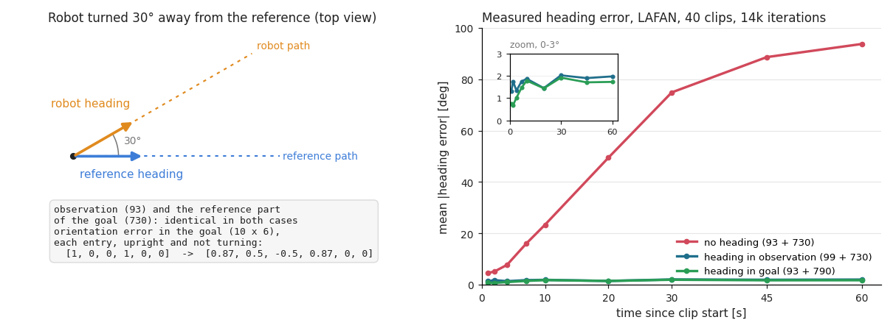

# Where the policy gets its heading

Our SuperMimic actor reads the paper's Table A.1 observation exactly: 93 proprioceptive numbers per control step, the
last 10 steps stacked (930 inputs). The goal holds 790 numbers: 730 describe the next 10 reference frames and come from
the reference alone; 60 give, for each of those frames, the reference pelvis orientation seen from the robot's current
pelvis (commit d0960c467). This note explains why the policy needs those 60 numbers, why they sit in the goal, and how
we got there: until that commit the same information was a 6-number term in the observation.

- Heading is the rotation about the vertical. Nothing in the 93 observation values or the 730 reference values changes
  when the robot turns away from the reference, so a policy that reads only them drifts: on LAFAN at 14k iterations
  its heading error reaches 23° after 10 s and 94° after 60 s, and its return is 0.581 instead of about 0.8.
- BeyondMimic, SONIC, realmimic, supermimic_vibed and Uni-SuperMimic all feed the policy an orientation error that
  needs only the robot's own orientation. SONIC puts it in the goal, one per future frame; supermimic_vibed and
  Uni-SuperMimic, which our previous layout copied, put it in the observation.
- The paper does not say where its policy gets heading. Our layout fits the reading in which the goal holds the
  reference seen from the robot, as in SONIC: paper-compatible under that reading, not proven paper-exact.
- In the goal, the observation is exactly Table A.1 and serves every goal interface sharing the decoder (paper App. B).
  In a 14k LAFAN A/B the two layouts match within one seed (heading error ≤ 2°, return 0.822 / 1 failed clip vs
  0.796 / 3, same speed); the goal layout drifts faster in position. A BONES-SEED retrain is running.

## 1. Preliminaries

**Frames.** The *world frame* is fixed, z up, one origin per simulated environment. The *robot pelvis frame* moves with
the robot pelvis; the gyro and the gravity direction are expressed in it. The *reference heading frame* sits at the
reference pelvis of frame k_t − 1, turned by that pelvis's heading only, so its z axis stays vertical. *Frame
indices*: the motion library is one long array of 50 Hz frames; at control step t the env holds k_t, the frame the
next reward is scored against, and the robot state is aligned with frame k_t − 1 (`MotionCommand.current_frames`,
`src/mjlab/tasks/tracking/mdp/commands.py:358-363`).

**Heading, heading error, orientation error.** *Heading* is the yaw of the pelvis about the world vertical. *Heading
error* is |yaw(robot pelvis) − yaw(reference pelvis)|, plotted in §2 and tabled in §5. *Orientation error* is the full
rotation R_robotᵀ R_ref from the robot pelvis to the reference pelvis, in 6D: the first two columns of the matrix, row
by row (`src/mjlab/tasks/tracking/mdp/kernels.py:301-308`). It reads [1, 0, 0, 1, 0, 0] with no error.

**Anchor.** The body that lines the reference up with the robot: the pelvis here (paper App. A; BeyondMimic uses
`torso_link`), also the floating-base root (`src/mjlab/tasks/tracking/config/g1/env_cfgs.py:207-209`). The root rewards
compare robot and reference anchor in the world frame. The body targets put the reference anchor at the robot anchor's
horizontal position, turned by the heading difference (`kernels.py:61-84`), so the body position and orientation
rewards ignore heading error. An episode ends on anchor height error above 0.25 m or *tilt error* above 0.8, the
difference of the vertical gravity component in the two pelvis frames (`kernels.py:221-233`; 78° if the reference is
upright).

**Arms and scores.** An *arm* is one training run of an A/B comparison (§5). Evaluation plays each clip once from frame
0 to its end with the deterministic policy. A clip's *normalised return* is its summed reward divided by (maximum step
reward × (clip frames − 1)), so a fall loses the rest of the clip; a clip *fails* if its episode ends early.

**What the actor sees** (`env_cfgs.py:171-187`, checked by
`src/mjlab/tasks/tracking/supermimic/model_interface.py:137-174`): Table A.1 with its noise, 93 per step, 10 steps
kept, 930 inputs. Nothing in it refers to the reference.

| term | dims | frame | sensor noise (uniform ±) |
|---|---|---|---|
| joint positions, q + encoder bias − q0 | 29 | joint space | 0.01 rad |
| joint velocities | 29 | joint space | 0.5 rad/s |
| angular velocity (pelvis gyro) | 3 | robot pelvis | 0.2 rad/s |
| gravity direction | 3 | robot pelvis | 0.05 |
| previous action | 29 | action space | none |

**What the goal is** (`env_cfgs.py:188-202`): two terms, 790 numbers, frames clamped at the clip end.

| part | dims | frames | expressed in | noise |
|---|---|---|---|---|
| reference: pelvis position minus the current reference pelvis position (3), pelvis orientation 6D (6), pelvis linear and angular velocity (3 + 3), joint positions (29), joint velocities × 0.1 (29) | 10 × 73 = 730 | k_t … k_t + 9 | reference heading frame of k_t − 1; velocities in each frame's own pelvis frame | none |
| orientation error R_robotᵀ R_ref(k_t + i) | 10 × 6 = 60 | k_t … k_t + 9 | robot pelvis frame of the current state | uniform ±0.05 |

The reference part depends on the frame index only (`commands.py:365-384`, `kernels.py:311-352`). The other part is
SONIC's `motion_anchor_ori_b_mf` on consecutive frames, computed by `MotionCommand.future_anchor_ori`
(`commands.py:386-395`) from the simulated pelvis orientation in the env (`mdp/observations.py:66-77`) and from the
imagined one in imagination (§4.4).

**The action.** 29 numbers a; joint j gets the setpoint q_sp = α_j a_j + q0_j, α_j = 0.25 τ_max,j / kp_j
(`src/mjlab/asset_zoo/robots/unitree_g1/g1_constants.py:280-288`). In data collection the simulator adds N(0, 0.1²) to
every action (`src/mjlab/rl/supermimic/runner.py:288`); imagined actions are noise-free.

**How the inputs are used.** The *policy* encodes the normalised goal with an MLP into a 32-number latent bounded by
tanh; a decoder MLP reads the latent and the 930 observation values (`src/mjlab/rl/supermimic/networks.py:34-46,
72-76`), so the orientation error reaches the decoder only through the latent. The *critic*, privileged and used in
training only, reads 900 numbers: heading-free state features (68), the noise-free goal (790), the sim context (33),
and the reference pelvis pose of frame k_t − 1 in the robot pelvis frame (3 + 6) (`model_interface.py:431-458`). The
*world model* predicts the state change in the pelvis frame from heading-free features, the action and the context.

## 2. The heading problem

Take a robot that is exactly on the reference except that it faces 30° to the left, say after a foot slipped. Joint
positions, joint velocities and the previous action live in joint space: unchanged. The gyro and the gravity direction
are in the pelvis frame, and turning the whole robot about the world vertical changes neither. The 730 reference
numbers come from the reference alone. With only these inputs a deterministic policy returns the same action, and on
flat ground the physics does not depend on heading: the robot performs the same motion turned by 30° and walks off at
30° to the reference path. It cannot see the error, so every heading disturbance adds up: foot slips, contact
asymmetries, the ±0.2 rad heading noise at every training reset
(`src/mjlab/tasks/tracking/tracking_env_cfg.py:144-151`). On the repo's kernels, turning random robot states by 30°
about the world vertical changes the 93 observation values by at most 2.4e-7. Only the orientation error changes: all
10 entries are turned by the 30°; for an upright pelvis and a reference that is not turning, each goes from
[1, 0, 0, 1, 0, 0] to [0.87, 0.5, −0.5, 0.87, 0, 0].



*Left: the thought experiment. Right: mean heading error, 40 LAFAN clips, 14k iterations, the three arms of §5; the
inset zooms on the two that see heading.*

The body position and orientation rewards ignore heading error (§1); the root and body velocity rewards compare
world-frame quantities and do see it (§5). The 10-step history does not help: over 0.2 s the gyro shows how fast the
robot has been turning, not how far it is off, which needs the turning of robot and reference summed since the episode
start. An IMU's orientation filter does that sum, and the orientation error hands its result to the policy. Its yaw
comes from the gyro and drifts slowly, so BeyondMimic's and SONIC's deploy code aligns the clip's heading with the
robot's when a clip starts.

## 3. What other codebases do

**BeyondMimic** (`HybridRobotics/whole_body_tracking@9db9158`; mjlab upstream@8bb2bc9) feeds its PPO actor one vector:
the current reference joints, the reference anchor (torso) pose in the robot anchor frame, `motion_anchor_pos_b` (3)
and `motion_anchor_ori_b` (6), and proprioception (`tracking_env_cfg.py:118-124`). Its variant without a position
estimate keeps only the orientation term (`config/g1/flat_env_cfg.py:35-39`; upstream `env_cfgs.py:74-79`); its
deploy controller turns the clip to the robot's heading at start (`motion_tracking_controller@742924f`,
`MotionCommand.cpp:37-43`).

**SONIC** (`NVlabs/GR00T-WholeBodyControl@1fa5f7f`, `gear_sonic`) has an encoder–decoder actor; its motion encoder reads
the reference joints and the orientation error of 10 future frames 0.1 s apart (`sonic_release.yaml:48-49, 87-89`):

```python
# gear_sonic/envs/manager_env/mdp/commands.py:1964-1976 (root_rot_dif_l_multi_future, line breaks joined)
ref_root_quat = self.motion_lib.get_root_quat_w(self.future_motion_ids, self.future_time_steps)
root_rot_dif = quat_mul(
    quat_inv(self.robot_anchor_quat_w.view(self.num_envs, 1, 4).repeat(1, self.num_future_frames, 1)),
    ref_root_quat.view(self.num_envs, self.num_future_frames, 4),
)
mat = matrix_from_quat(root_rot_dif)
root_rot_dif_l_mat = mat[..., :2].reshape(mat.shape[0], -1)
```

The anchor is the pelvis (`motion.yaml:47`); the decoder reads the latent and pure proprioception over 10 steps
(`g1_dyn_mlp.yaml:1-3`, `local_dir_hist.yaml:3-8`). On the robot the runtime turns the reference to the robot's heading
when a clip starts and computes the error from the pelvis IMU (`g1_deploy_onnx_ref.cpp:559-605`).

**realmimic** (`kevinhenryzz/realmimic@61f2973`), a single-GPU SuperMimic reproduction, appends an anchor term to the
goal (`goal_spec.py:3-10`): one 6D torso orientation error by default (`config.py:45`), SONIC's form for its 10 goal
frames in the released model (`presets.py:28-29`), recomputed from the imagined state (`imagination/compiled.py:83-94`).

**SuperMimic-Reproduced** (`CuboiLeo/SuperMimic-Reproduced@d9be385`) can add BeyondMimic's anchor pose (9) to its
reference-only goal, off by default (`envs/tracking_env_cfg.py:90`). Its log (`docs/EXPERIMENTS.md`, in Chinese):
without the term LAFAN plateaus at 0.56–0.59 with 82° mean heading error (lines 57-62, 113-156), with it 0.82 after
1.66 h (64-75). It kept the term off for paper-comparable runs (110), argued that a policy with no root reward can still
reach 5/6 ≈ 0.833 under its weights (111; our root terms are 1/5 of the maximum), and noted that the paper may not play
whole LAFAN clips (158).

**supermimic_vibed** (`zita-ch/supermimic_vibed@a1508d4`) adds a 6D "relative rotation" to Table A.1 (99,
`supermimic/mdp.py:96-103`) and lists it as a deviation (README:171-172); **Uni-SuperMimic** (`@bc0f0f3`) copies that
layout (`.../g1/supermimic/mdp.py:24, 117-133`), and our previous layout came from it (`kernels.py:304-306, 321-323`).

| codebase | heading information | where | frames | anchor | needs a position estimate |
|---|---|---|---|---|---|
| BeyondMimic, no-state-estimation variant | `motion_anchor_ori_b`, 6 | the single actor input | current | torso | no |
| SONIC release | `motion_anchor_ori_b_mf`, 10 × 6 | goal (encoder) | 10 future, 0.1 s apart | pelvis | no |
| realmimic release (default) | `pelvis_ori10`, 10 × 6 (`ori`, 6) | goal | 10 future, consecutive (current) | pelvis (torso) | no |
| SuperMimic-Reproduced | anchor pose, 9; off by default | goal | current | torso | yes |
| supermimic_vibed, Uni-SuperMimic, ours until d0960c467 | relative rotation (`motion_current_anchor_ori_b`), 6 | observation | current | pelvis | no |
| **ours** | `motion_future_anchor_ori_b`, 10 × 6 | goal | 10 future, consecutive (k_t … k_t + 9) | pelvis | no |
| SuperMimic paper | not stated | – | – | – | – |

## 4. Observation or goal

### 4.1 What the paper says

The paper (arXiv:2610.28480): "for motion tracking, g_t is read from a reference motion", and "a hat marks the
world-model counterpart of a simulator quantity" (§3.1, p. 4). App. A (p. 13): "The motion-tracking interface follows
the BeyondMimic formulation [3]"; the observation is Table A.1; "we condition the encoder on a K = 10 future reference
sequence rather than a single-frame target." App. B (p. 14) and Table A.4 (p. 15): one encoder per goal interface, one
shared decoder reading "z, last 10 frames of o". It never says in which frame the future reference is written, never
mentions an anchor, never says how the policy knows its heading. Three readings fit:

1. **The goal depends on the reference only.** The notation leans this way: g_t never carries a hat in imagination
   (Alg. A.1, p. 15), and noise is defined for o only. The policy would be heading-blind, like our no-heading arm.
2. **The goal holds the reference seen from the robot, as in SONIC,** which the paper compares itself with.
   BeyondMimic keeps `motion_anchor_ori_b` even without a position estimate.
3. **"Follows BeyondMimic" includes its anchor terms**, possibly the position term, which needs a position estimate.

The results do not settle it. The paper reaches "a return of 0.82 in evaluation within 1.2 h" on LAFAN, each checkpoint
"scored on all 40 clips" (§4.1, Fig. 4, pp. 6-7). If that plays whole clips (1.7 to 4.6 minutes), reading 1 is
unlikely: heading-blind policies plateau at 0.581 in our runs (§5) and 0.56–0.59 in SuperMimic-Reproduced's. But "each
motion plays once from its first frame" (App. F.1, p. 17) describes the BONES-SEED benchmark, and for LAFAN the paper
does not say how long a clip plays. Over the first 10 s of each clip (our training episode length,
`tracking_env_cfg.py:313`) our heading-blind arm scores 0.870, over 15 s 0.827, both above 0.82; BONES-SEED clips are
short (our library: median 5.8 s, 90th percentile 12.6 s). Our layout is exact for Table A.1 and paper-compatible
under reading 2; under reading 1 both our layouts deviate from the paper.

### 4.2 Where it was before, and why

Until d0960c467 the orientation error was a 6-number actor term, `motion_current_anchor_ori_b`, for frame k_t − 1, with
uniform ±0.05 noise: 99 per step (990 inputs), a 730-number goal, an 840-number critic input, inherited from
supermimic_vibed through Uni-SuperMimic. The previous task removed it to match Table A.1, measured the drift (first
ablation, §5) and put it back (daf15a0ca). The learner already rebuilt the observation from imagined states with sensor
noise and a 10-step history, so the term needed no extra code.

### 4.3 Where it is now, and why

- **Deployability is unchanged.** Both layouts need only the pelvis orientation from the IMU, no position estimate.
- **The observation is exactly Table A.1.** Only where heading enters stays open, and the text allows the goal (§4.1).
- **The decoder can be shared across goal interfaces.** The paper's App. B trains several goal interfaces (motion,
  velocity, …), each with its own encoder, and one decoder. A reference-relative term in the observation means nothing
  for a velocity command, which has no reference motion; in the goal it belongs to the motion encoder.
- **It is SONIC's form**, also used by realmimic's released model.

Cost: none measured. Median time per iteration over quiet rows (from iteration 5000, no checkpoint rows, no rows slowed
by a shared GPU): 211.7 ms with heading in the goal, 212.0 ms in the observation, 203.6 ms without. The policy phase is
2.9 ms faster in the goal layout (81.7 vs 84.6 ms), likely because the 6-number term ran forward kinematics for the
pelvis orientation where the state's root quaternion, which the goal now reads, would have served. The simulator
(+1.1 ms, the goal term and its noise) and critic (+1.4 ms, 900 inputs) phases give that back.

With the move, the orientation error loses its 10-step history (the goal is one snapshot), passes through the 32-number
latent, and covers frames k_t … k_t + 9 instead of k_t − 1. Not taken: a goal in the robot's heading frame (ill-defined
when the pelvis points straight up or down); `motion_anchor_pos_b` (needs a position estimate, §6); a recurrent policy
that learns heading (re-learns the IMU's orientation filter).

### 4.4 What changed in the code (commit d0960c467)

- **Env** (`env_cfgs.py:171-203`): the actor term `motion_anchor_ori` is removed. The goal group gains
  `motion_future_anchor_ori` (10 frames, the removed term's uniform ±0.05 noise) and `enable_corruption=not play`;
  mjlab's default is False (`src/mjlab/managers/observation_manager.py:87`), so without it the goal gets no noise.
- **Interface** (`model_interface.py`): `_init_goal` (190-224) checks the two goal terms and their frames, reads their
  noise, and requires the anchor to be the root body, so that `goal(s, frame)` (406-419) reads the robot pelvis
  orientation from the state's root quaternion s[3:7] (`src/mjlab/rl/supermimic/interface.py:205-232`) without forward
  kinematics. The goal is now differentiable in the state; `add_goal_noise` (421-429) adds each goal term's noise.
- **Imagination** (`src/mjlab/rl/supermimic/algorithm.py`): `update_policy` draws the goal noise for all H imagined
  policy calls up front (395-403); `imagine_step` feeds `goal + goal_noise` to the policy only (306). `state_heads`
  (248-252) still returns the noise-free goal, which feeds the critic's bootstrap value (354-358), the stored rollout
  (471-479) and the critic fit (494-502). The noise models the robot's sensors and only the actor runs on the robot;
  the privileged critic also reads the true pelvis pose, and noise would only add variance to its value targets.
- **Dims**: goal 790, critic 900 (68 + 790 + 33 + 9). The goal normaliser now sees the policy's own heading errors
  (until iteration 20,000, `src/mjlab/rl/supermimic/config.py:66`). Replay buffer and world model never see goals.
  Observation-layout checkpoints do not load. `tests/test_supermimic_interface.py` checks the goal and its gradient.

## 5. Evidence

Two ablations on LAFAN (40 clips, 2.45 h): no heading against heading in the observation, then observation against
goal. All arms: 14k iterations, 4096 envs, seed 42, self-collision on, one seed each.

| arm | actor per step / goal / critic | trained at | run in `runs/lafan/` |
|---|---|---|---|
| no heading | 93 / 730 / 840 | 8cf671709 | `2026-10-26_12-53-29_update` |
| heading in observation | 99 / 730 / 840 | 8cf671709 + the term (= daf15a0ca) | `2026-10-26_16-48-33_update_obs99` |
| heading in goal | 93 / 790 / 900 | cf3b1ec9d (same tree as d0960c467) | `2026-10-27_19-45-50_goal_heading` |

The goal arm trains with njmax 350, the others with 250; neither the observation arm nor the goal arm overflowed, and
without overflow both values give identical physics. Evaluation (§1, at 8cf671709, 92c228d2a and cf3b1ec9d): friction
1.0, no noise; results in `eval_library_model_<iteration>.json` in each run folder (local; copies and scripts are kept
with the task notes). Mean normalised return / failed clips of 40:

| iteration | no heading | heading in observation | heading in goal |
|---|---|---|---|
| 2000 | 0.363 / 18 | 0.526 / 17 | 0.450 / 22 |
| 8000 | 0.576 / 3 | 0.798 / 2 | 0.778 / 6 |
| 14000 | 0.581 / 1 | 0.796 / 3 | **0.822 / 1** |
| mean of 8k, 10k, 12k, 14k / failed summed | 0.561 / 11 | 0.802 / 8 | 0.797 / 12 |

Failing clips change between checkpoints; repeated evaluations vary by about ±1–2. Per survived step (reward over the
steps the rollout lasted) the goal arm is lower at all 7 checkpoints, by 0.0004 to 0.016 (0.826 vs 0.836 at 14k).

Reward by term at 14k, on the 35 clips all three arms survive (maximum: weight / 5, 0.1 for root, 0.2 for body terms):

| term | no heading | heading in observation | heading in goal |
|---|---|---|---|
| root position (world) | 0.006 | 0.018 | 0.010 |
| root orientation (world) | 0.016 | 0.098 | 0.098 |
| body positions (heading-aligned) | 0.194 | 0.196 | 0.196 |
| body orientations (heading-aligned) | 0.165 | 0.174 | 0.174 |
| body linear velocities (world) | 0.111 | 0.187 | 0.186 |
| body angular velocities (world) | 0.111 | 0.180 | 0.180 |
| total, with penalties | 0.591 | 0.839 | 0.830 |

First ablation: the heading-aligned terms are almost equal and the world-frame terms collapse without heading. Second:
the two layouts agree to 0.001 on every term except root position.

Mean heading error (°) over the 40 clips, replaying each `model_14000.pt`, averaged over a 0.5 s window ending at t:

| t (s) | 1 | 2 | 4 | 7 | 10 | 20 | 30 | 45 | 60 |
|---|---|---|---|---|---|---|---|---|---|
| no heading | 4.6 | 5.1 | 7.7 | 15.9 | 23.3 | 49.4 | 74.9 | 88.6 | 93.7 |
| heading in observation | 1.3 | 1.7 | 1.3 | 1.8 | 1.9 | 1.4 | 2.0 | 1.9 | 2.0 |
| heading in goal | 0.8 | 0.7 | 1.0 | 1.5 | 1.8 | 1.4 | 1.9 | 1.7 | 1.7 |

Both arms that see heading hold it at ≤ 2°, including a one-frame offset in the measurement: it compares the robot with
reference frame k_t while the state is aligned with k_t − 1, and the LAFAN pelvis turns 0.92° per frame on average over
the first 60 s. Mean normalised step return over the first 5 / 10 / 15 / 60 s: no heading 0.934 / 0.870 / 0.827 /
0.658; heading in observation 0.963 / 0.937 / 0.920 / 0.867; heading in goal 0.966 / 0.933 / 0.910 / 0.853.

## 6. Status and open questions

- **BONES-SEED.** The shipped `checkpoints/seed/model_144000.pt` has the observation layout and does not load on the
  current code. A 160k-iteration retrain with the goal layout started on 2026-10-27, 21:02 Dubai time (10 to 13 h, log
  `runs/seed/train_seed_goal_heading.log`); until it is evaluated, BONES-SEED numbers here are the observation layout's.
- **One seed per arm.** The goal arm's 0.01 deficit per survived step and its faster drift may be this seed; a second
  seed of both arms (about 1 h each on one GPU) would tell.
- **Position drift.** Neither layout observes position, so both drift, the goal arm faster: its mean root-position
  reward kernel exp(−|e|² / 0.3²) (e the pelvis position error in metres) is 0.56 vs 0.71 at 10 s, 0.09 vs 0.17 at
  60 s. One untested explanation: the observation layout saw a 10-step history of the orientation error.
- **Would `motion_anchor_pos_b` help?** The reference pelvis position in the robot pelvis frame would show the policy
  its position error and should remove the drift, but it needs a position estimate, which an IMU alone does not give.
- **Goal noise volume.** Imagination draws noise for all 790 goal numbers (32 × 4096 × 790 floats, 414 MB per
  iteration), 92 % of them zeros. Drawing only the 60 noisy numbers would be leaner; the speed gain is not measured.
